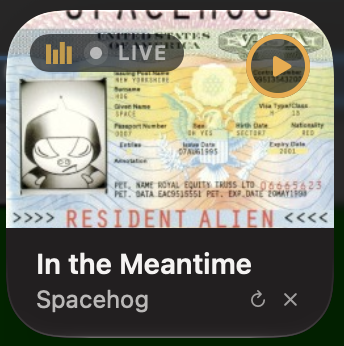
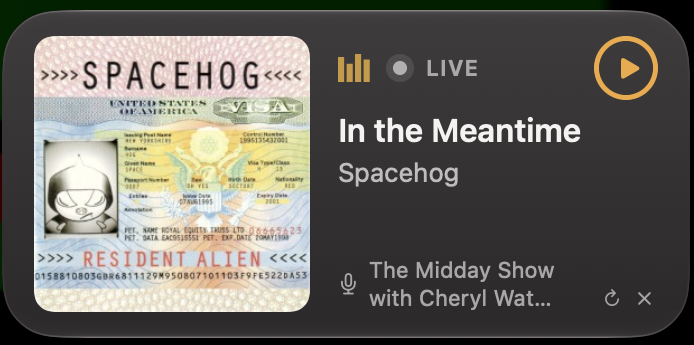
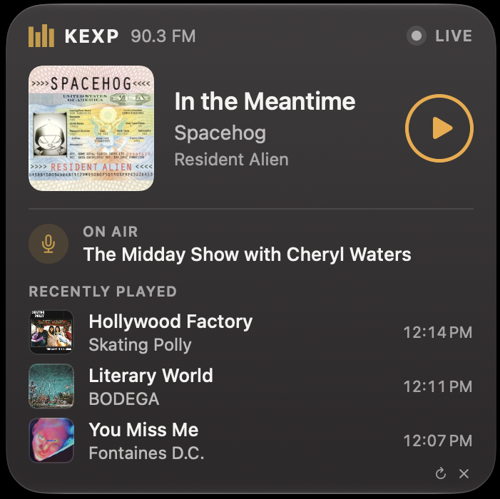

# KEXP Now Playing

<p>
  
  
  
</p>

macOS widget + background player for KEXP 90.3 FM, with Now Playing / media-key support. Requires macOS 15+.

## Install

1. Download the latest `.dmg` from [Releases](https://github.com/stephencattaneo/kexp_osx_widget/releases/latest).
2. Open it and drag **KEXP Now Playing** to **Applications**.
3. Open the app. macOS will block it (unverified developer) → **System Settings › Privacy & Security** → **Open Anyway**.
   1. This is required because I don't have a paid Apple Developer account.
5. Right-click the desktop → **Edit Widgets…** → search **KEXP**.

The app runs in the background (no Dock or menu-bar icon) and handles playback and live track updates.
Play/pause from the widget, macOS Now Playing, or media keys. Quit: `open kexpnowplaying://quit`.

### Or build from source

Needs Xcode 26+.

```sh
brew install xcodegen
rake install   # builds, installs to /Applications, and launches
```

## Uninstall

macOS won't trash the app while it's running, so quit it first:

1. Remove the KEXP widget from your desktop (right-click it → **Remove Widget**).
2. Quit the app: `open kexpnowplaying://quit` (or `pkill -x "KEXP Now Playing"`, or Activity Monitor → search "KEXP" → Quit).
3. Drag **KEXP Now Playing** from **Applications** to the Trash.

## Releasing (maintainer)

`rake release` does the whole thing: bumps the version in `project.yml` (next minor version, or `rake "release[2.0]"` for a specific one), builds the DMG, commits, tags, pushes, and publishes the GitHub release with the DMG attached. It checks first that you're on an up-to-date, clean `main`. `rake package` builds the DMG without releasing.

Release when user-facing behavior changes; no need for README/script-only changes.
