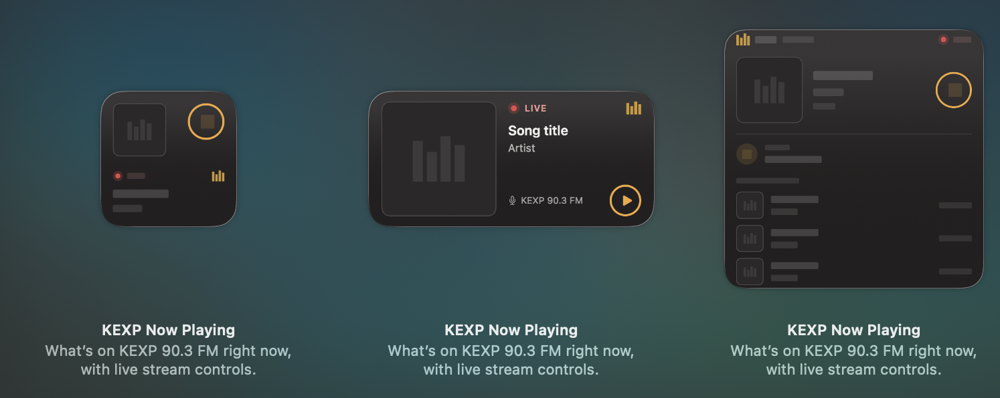

# KEXP Now Playing



macOS widget + background player for KEXP 90.3 FM, with Now Playing / media-key support. Requires macOS 15+.

## Install

1. Download the latest `.dmg` from [Releases](https://github.com/stephencattaneo/kexp_osx_widget/releases/latest).
2. Open it and drag **KEXP Now Playing** to **Applications**.
3. Open the app. macOS will block it (unverified developer) → **System Settings › Privacy & Security** → **Open Anyway**.
   1. This is required because I don't have a paid Apple Developer account.
5. Right-click the desktop → **Edit Widgets…** → search **KEXP**.

The app runs in the background (no Dock or menu-bar icon) and handles playback and live track updates.
Play/pause from the widget, macOS Now Playing, or media keys. Quit: `open kexpnowplaying://quit`.

### Or build from source

Needs Xcode 26+.

```sh
brew install xcodegen
./scripts/build.sh --open
```

## Releasing (maintainer)

1. Bump `MARKETING_VERSION` in `project.yml`, commit, push.
2. `./scripts/package.sh` → `dist/KEXP-Now-Playing-<version>.dmg`
3. `gh release create v<version> dist/KEXP-Now-Playing-<version>.dmg --generate-notes`

Release when user-facing behavior changes; no need for README/script-only changes.
